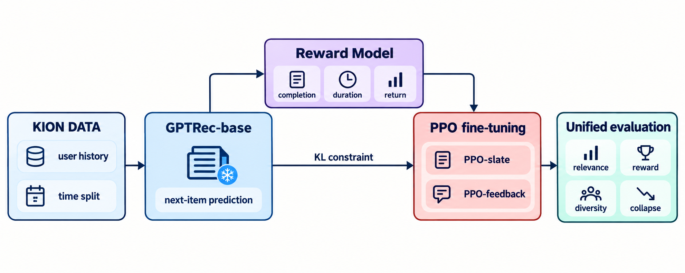
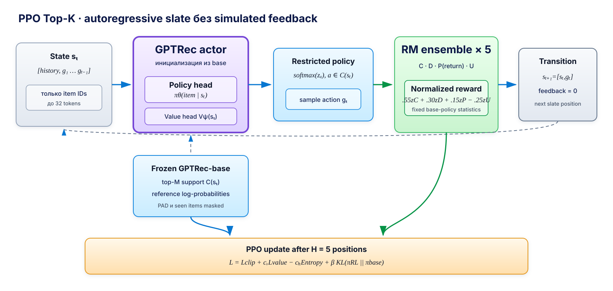
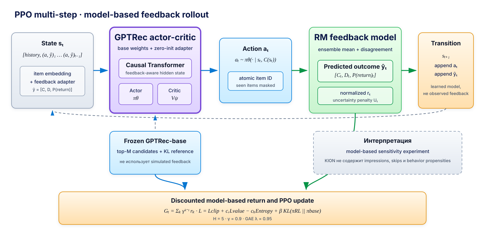
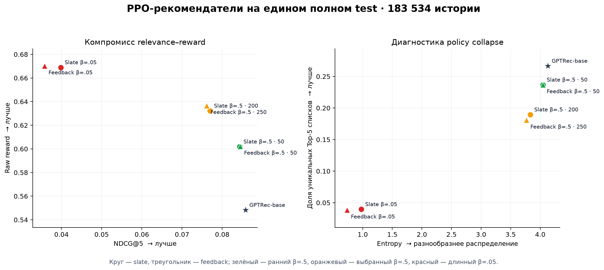

# T-Lab RecSys: GPTRec, Reward Model и PPO

> **Главный результат.** При алгоритме Proximal Policy Optimization (PPO), сильном
> штрафе за отклонение от исходной модели
> (`β=0.5`) и ранней остановке после 50 обновлений параметров
> ожидаемый reward вырос примерно на **9.8%**, Recall@5 практически не изменился,
> а NDCG@5 снизился только на **1.5–1.7%**. Слабая KL-регуляризация `β=0.05` дала
> около **+22% reward**, но привела к падению NDCG на 54–58% и схлопыванию
> рекомендательной стратегии, модель стала выдавать небольшой набор похожих items.

## Содержание

1. [Постановка задачи](#постановка-задачи)
2. [Ключевые термины и метрики](#ключевые-термины-и-метрики)
3. [Источники идей и отличия реализации](#источники-идей-и-отличия-реализации)
4. [Данные и временное разбиение](#данные-и-временное-разбиение)
5. [Архитектура решения](#архитектура-решения)
6. [Протокол оценки](#протокол-оценки)
7. [Результаты](#результаты)
8. [Примеры рекомендаций](#примеры-рекомендаций)
9. [Ответы на исследовательские вопросы](#ответы-на-исследовательские-вопросы)
10. [Ограничения](#ограничения)
11. [Воспроизведение](#воспроизведение)

## Постановка задачи

У пользователя есть последовательность просмотренных объектов. Базовая модель
получает историю из item ID и предсказывает следующий item. Затем добавляется reward
model, которая для пары `(история, candidate item)` оценивает возможный отклик:

- насколько полно пользователь посмотрит объект;
- сколько времени он проведёт за просмотром;
- вернётся ли он в сервис в течение семи дней.

На третьем этапе GPTRec дообучается с помощью PPO. Цель исследования — изучить компромисс между reward,
релевантностью, разнообразием и устойчивостью рекомендаций.



## Ключевые термины и метрики

### PPO и функция потерь

| Термин | Что означает в проекте |
|---|---|
| **KL divergence** | Мера отличия новой рекомендательной стратегии `πRL` от исходной `πbase`. |
| **β (бета)** | Вес KL-штрафа. Чем больше `β`, тем сильнее PPO удерживается около GPTRec-base и тем меньше риск потерять релевантность. Это не процент и не вероятность. |
| **critic, `V(s)`** | Часть actor-critic, которая прогнозирует ожидаемую будущую награду и служит baseline для менее шумного обучения. |
| **advantage** | Насколько выбранное действие оказалось лучше или хуже ожидания critic. |
| **GAE** | Generalized Advantage Estimation — способ оценить advantage по многошаговой последовательности с меньшей дисперсией. |
| **entropy** | Мера ширины распределения рекомендаций. Очень низкая entropy указывает, что модель почти всегда выбирает небольшой набор items. |
| **discounted return** | Сумма наград на текущем и будущих шагах, где дальние шаги имеют меньший вес. Не путать с `P(return)` — вероятностью возвращения пользователя в сервис. |
| **policy collapse** | Схлопывание рекомендаций: ограниченный набор объектов выдаётся большому числу пользователей. |

При `β=0.5` коэффициент KL-штрафа в десять раз больше, чем при `β=0.05`.
Эксперименты ниже показывают, что именно это различие отделяет осторожное улучшение
reward от сильного схлопывания рекомендаций.

### Метрики

| Метрика | Что измеряет |
|---|---|
| **Recall@K** | Попал ли реальный следующий item в первые `K` рекомендаций. Больше — лучше. |
| **NDCG@K** | Учитывает и попадание, и его позицию: правильный item в начале списка ценится выше. Больше — лучше. |
| **raw reward** | Исходная оценка Reward Model по заданной формуле. Больше — лучше, но только пока не теряются relevance и diversity. |
| **KL** | Насколько RL-модель отклонилась от GPTRec-base. |
| **entropy** | Насколько распределение рекомендаций остаётся широким. |
| **ILD** | Intra-List Diversity — жанровое разнообразие внутри одного Top-K. Больше — разнообразнее. |
| **catalog coverage** | Доля каталога, которая хотя бы раз встретилась в рекомендациях. |
| **top-10 action share** | Доля всех позиций, занятая десятью самыми часто рекомендуемыми items. Меньше — менее концентрированная выдача. |
| **unique slate rate** | Доля различных Top-5 списков среди всех пользователей. |
| **NLL / log loss** | Ошибка вероятностного прогноза Reward Model. Меньше — лучше. |
| **MAE** | Средняя абсолютная ошибка численного прогноза. Меньше — лучше. |
| **ECE** | Ошибка калибровки вероятностей. Меньше — лучше. |

**OPE** означает offline policy evaluation — оценку новой стратегии по готовым
логам без онлайн A/B-теста. Методы **IPS** и **DR** являются вариантами OPE, но здесь
не применяются, потому что в KION неизвестны вероятности исторических показов.

## Источники идей и отличия реализации

### 1. GPTRec и PPO для целей помимо точности

Основной источник архитектуры — работа Petrov и Macdonald
[«Aligning GPTRec with Beyond-Accuracy Goals with Reinforcement Learning»
(2024)](https://arxiv.org/abs/2403.04875).

Из статьи взяты:

- Последовательная генерация Next-K: items генерируются по одному, а уже сгенерированная часть
  списка (prefix) влияет на следующую позицию;
- двухэтапная схема «обычное обучение GPTRec на правильных следующих items →
  RL-дообучение по награде»;
- PPO actor-critic, critic как базовый уровень ожидаемой награды (value baseline),
  дисконтированная сумма наград и GAE;
- идея оценивать не только accuracy, но и поведение всего recommendation slate.

Что изменено в этом проекте:

- в статье оптимизируются заданные list-level метрики diversity и popularity, а здесь
  reward предсказывается отдельным ансамблем RM по completion, duration и return;
- critic не является вторым Transformer: actor и value head используют одну общую
  основную часть GPTRec, чтобы уменьшить стоимость обучения;
- каталог KION содержит 15 тысяч items, поэтому на каждом шаге исходная замороженная
  GPTRec-base сначала отбирает 100 наиболее вероятных кандидатов, и PPO выбирает
  действие только среди них;
- добавлены поощрение энтропии и KL-штраф относительно замороженной GPTRec-base;
- отдельно измеряются использование ошибок RM ради формального роста reward (reward
  hacking), охват каталога, концентрация рекомендаций и доля уникальных списков.

### 2. Multi-step feedback и долгосрочный reward

Идея второго режима основана на работе Matveev et al.
[«Session-Level Optimization for Large-Scale Retrieval using REINFORCE with
Multi-Step Off-Policy Correction» (2026)](https://arxiv.org/abs/2607.02818).

Из статьи взяты:

- постановка рекомендации как последовательности решений с дисконтированной суммой
  наград;
- идея модели обратной связи пользователя, предсказывающей реакцию после каждого
  выбранного item;
- многошаговая генерация с передачей прогноза реакции следующим шагам;
- разделение обычной релевантности и долгосрочной награды за всю сессию;
- осторожная интерпретация offline-оценки, основанной на прогнозах модели, а не на
  реально наблюдавшихся реакциях.

Что адаптировано:

- вместо like/listened ratio RM предсказывает completion, duration и 7-day return;
- модуль feedback получает ожидаемые прогнозы, а не случайно сгенерированную реакцию;
- `feedback` рассматривается как эксперимент на чувствительность результата к
  смоделированной реакции, а `slate` — как основной вариант, не притворяющийся
  наблюдаемым взаимодействием пользователя.

Что не переносилось из статьи:

- off-policy REINFORCE — обучение по действиям другой, исторической policy;
- multi-step importance sampling (перевзвешивание исторических примеров);
- doubly robust OPE (DR, комбинированная offline-оценка policy);
- оценка отношения вероятностей новой и исторической policy;
- выбор лучшего из `N` сгенерированных вариантов во время применения модели.

KION не содержит impression logs и вероятностей logging policy. Без них
веса для исправления смещения данных нельзя оценить корректно, а IPS/DR создавали бы
видимость строгой offline-оценки без необходимых данных.

### 3. PPO, GAE и KL-регуляризация

Технические компоненты основаны на первичных работах:

- [Proximal Policy Optimization Algorithms](https://arxiv.org/abs/1707.06347) —
  ограничение размера обновления policy и несколько проходов по небольшим пакетам
  обучающих примеров;
- [Generalized Advantage Estimation](https://arxiv.org/abs/1506.02438) — critic как
  baseline и оценка advantages с меньшей дисперсией;
- [InstructGPT / RLHF](https://arxiv.org/abs/2203.02155) — идея обучения с
  подкреплением по оценкам reward model и удержания обновлённой policy рядом с
  исходной;
- [Scaling Laws for Reward Model Overoptimization](https://arxiv.org/abs/2210.10760)
  — мотивация отдельно проверять чрезмерную оптимизацию proxy reward и влияние KL.

### Что пробовалось и что получилось

| Идея | Зачем проверялась | Результат |
|---|---|---|
| PPO-slate | Оптимизировать последовательный Top-5 без выдуманной реакции | Сработал при сильном KL и ранней остановке |
| PPO-feedback | Проверить пользу прогнозируемого отклика между шагами | Не дал убедительного преимущества; при долгом обучении сильнее накапливал ошибки модели |
| `β=0.05`, 7 429 updates | Проверить агрессивную оптимизацию reward | Не сработал как рекомендатель: reward вырос, но возник policy collapse |
| `β=0.5`, 500 updates | Удержать policy рядом с GPTRec-base | Сработал; лучший практический checkpoint найден уже на update 50 |
| Разные веса `C/D/P/U` | Проверить чувствительность reward | Top-10 менялся мало: overlap 95.6–99.0% |
| IPS/DR и коррекция вероятностей показа | Получить строгую offline-оценку новой policy | Не применялись: неизвестно, какие объекты были показаны и с какой вероятностью |

## Данные и временное разбиение

Используется датасет KION: последовательности просмотров, длительность, доля просмотра,
тип контента и жанры. Каталог GPTRec содержит 15 415 items и отдельный служебный
токен PAD для заполнения коротких историй до одинаковой длины.


### GPTRec-base

| Split | Период | Назначение |
|---|---|---|
| Train | до 08.08.2021 включительно | Next-item обучение |
| Validation | 09.08–15.08.2021 | Выбор checkpoint |
| Standard test | после 15.08.2021 | Исходная оценка GPTRec |

### Reward model и PPO

| Split | Период | Назначение |
|---|---|---|
| Train | до 01.08.2021 включительно | Обучение RM и PPO rollouts |
| Embargo | 02.08–08.08.2021 | Разделяет train и будущую оценку |
| Calibration | 09.08–11.08.2021 | Калибровка и выбор PPO checkpoint |
| Test | 12.08–15.08.2021 | Финальное сравнение на 183 534 историях |
| Future window | 16.08–22.08.2021 | Формирование 7-day return labels |

Защита от утечек:

- словарь item ID строится только по train GPTRec;
- популярность, жанровый словарь и нормализация metadata считаются по train;
- история RM содержит события только из предыдущих календарных дней;
- test не используется для выбора PPO checkpoint;
- все итоговые policy сравниваются на одних и тех же 183 534 историях.

В KION нет времени просмотра, поэтому RM не включает события текущего дня в историю. 
Дополнительное ограничение протокола: validation исходной GPTRec пересекается по датам с PPO test. Градиенты по
этим данным не считались, а выбранный десятый epoch был последним фиксированным
epoch, однако это остаётся ограничением model-selection protocol.

## Архитектура решения

### 1. GPTRec-base

GPTRec — небольшой GPT-2-подобный causal Transformer: при предсказании следующего
item он видит только предыдущую часть последовательности. Токенами являются целые
item ID, а задача обучения — предсказание следующего объекта.


| Параметр | Значение |
|---|---:|
| Максимальная длина истории | 32 |
| Transformer layers | 2 |
| Hidden size | 128 |
| Attention heads | 4 |
| Dropout | 0.1 |
| Параметров | 2 374 144 |

### 2. Reward model

Reward model получает историю пользователя, candidate item и metadata. Замороженная GPTRec кодирует историю и item, после чего блок Multi-gate Mixture-of-Experts решает три связанные задачи.


Ансамбль из пяти моделей предсказывает:

- `C` — expected completion utility в диапазоне `[0, 1]`;
- `D` — нормированную duration utility;
- `P(return)` — вероятность следующего активного дня в течение семи дней;
- `U` — степень расхождения прогнозов пяти RM, используемая как приближение
  неуверенности модели.

Итоговый raw reward:

```text
R = 0.55C + 0.30D + 0.15P(return) − 0.25U
```

Перед PPO каждый компонент отдельно стандартизируется: из него вычитается среднее и
результат делится на стандартное отклонение, рассчитанные на действиях замороженной
GPTRec-base. Это приводит разные компоненты примерно к одному масштабу. Полученные
статистики фиксируются и одинаковы во всех сравниваемых запусках.

Подробное описание входов, MMoE, вероятностных выходов и калибровки находится в
[документе по Reward Model](docs/reward-model-architecture.md).

### 3. PPO actor-critic

Actor и critic используют один общий Transformer GPTRec. Actor выдаёт для каждого
item logits, которые затем превращаются в вероятности, а
value head оценивает ожидаемую будущую награду состояния `V(s)`. Замороженная
GPTRec-base формирует Top-100 кандидатов и служит эталонной policy, от которой новая
модель не должна уходить слишком далеко.

Минимизируемый loss:

```text
L = Lclip + 0.5 Lvalue − 0.01 Entropy + β KL(πRL || πbase)
```

Эту формулу можно читать так:

- `Lclip` обучает actor чаще выбирать действия с положительным advantage, но PPO
  ограничивает размер одного изменения policy;
- `Lvalue` обучает critic предсказывать ожидаемую награду; коэффициент `0.5` задаёт
  вес ошибки critic;
- `−0.01 Entropy` поощряет сохранять несколько вероятных вариантов вместо слишком
  раннего выбора одних и тех же items;
- `KL(πRL || πbase)` штрафует отличие новой policy от GPTRec-base;
- `β` управляет силой последнего штрафа. В эксперименте `β=0.5` лучше сохраняет
  релевантность, а `β=0.05` позволяет сильнее оптимизировать RM и приводит к
  схлопыванию policy.

`L` минимизируется, поэтому штрафы прибавляются, а полезная для разнообразия entropy
вычитается. Числа `0.5`, `0.01` и `β` — гиперпараметры, то есть заранее выбранные
настройки обучения, а не значения, выученные моделью.

Реализованы два варианта перехода состояния.

#### PPO-slate



Модель последовательно строит Top-5. После каждого шага в контекст добавляется только
выбранный item ID. Это не означает, что пользователь действительно посмотрел item:
генерируется один recommendation slate, а не пять будущих сессий.

#### PPO-feedback



После выбора item ансамбль RM предсказывает `(C, D, P(return))`. Эти значения через
небольшой feedback adapter, изначально не меняющий представление состояния,
передаются следующему шагу. Такой rollout — проверка чувствительности к
смоделированной обратной связи, а не наблюдаемая реакция пользователя.

Подробные схемы генерации обучающих последовательностей, нормализации reward, GAE и
выбора сохранённой версии модели находятся в
[документе по PPO](docs/rl-architecture.md).

## Протокол оценки

Финальное сравнение выполняется одним evaluation-only скриптом для всех policy:

- один полный test из 183 534 историй;
- одинаковый target next-item;
- одни и те же 100 кандидатов, предварительно выбранных замороженной GPTRec-base;
- последовательный Top-5 без случайного сэмплирования: на каждом шаге берётся самый
  вероятный допустимый item, после чего он учитывается при выборе следующего;
- запрет специального токена заполнения пустых позиций (PAD), уже просмотренных
  items и повторов внутри одного списка;
- один ансамбль RM и одна reward-нормализация.

Метрики:

- **Recall@5, NDCG@5** — релевантность относительно следующего item;
- **raw reward** — исходная оценка RM по формуле `R`; **normalized reward** — та же
  оценка после приведения компонентов к сопоставимому масштабу для обучения PPO;
- **KL и entropy** — сила отклонения от GPTRec-base и концентрация policy;
- **catalog coverage** — доля каталога, встретившаяся в рекомендациях;
- **ILD** — внутрисписковое жанровое разнообразие;
- **top-1/top-10 action share** — какая доля всех позиций занята одним самым частым
  item или десятью самыми частыми items;
- **unique slate rate** — доля различных Top-5 списков среди всех пользователей;
- **duplicate pair rate** — доля пар одинаковых items внутри одного списка.

Сохранённая версия PPO выбирается только на отдельной калибровочной части данных. Она
считается допустимой, если сохраняет не менее 90% NDCG исходной модели на этой части.
Финальный test используется после выбора версии. Для итоговой исследовательской
таблицы все сохранённые policy затем повторно оценены без дополнительного обучения
по одному протоколу.

## Результаты

### Reward model

Средние метрики ансамбля на 183 534 test-примерах:

| Прогнозируемая величина | Метрика ошибки ↓ | RM | Константный baseline |
|---|---|---:|---:|
| Completion | NLL | **1.560** | 1.745 |
| Duration | MAE | **0.200** | 0.224 |
| Return | Log loss | **0.601** | 0.646 |

Дополнительная диагностика:

- completion ECE: `0.014`;
- return ECE: `0.028`;
- корреляция reward с train-популярностью: `0.140`;
- среднее изменение reward после перестановки пользовательских историй: `0.029`;
- неуверенность выше для редких items: `0.024` против `0.017` у популярных items.

Последний пункт показывает важное ограничение: RM использует историю, но её влияние
намного слабее item-сигнала. Поэтому высокий reward нельзя считать независимым
доказательством пользовательской пользы.

### Чувствительность reward

Проверялись варианты с увеличением и уменьшением весов completion, duration,
`P(return)` и uncertainty penalty. Изменение весов сохраняло 95.6–99.0% состава
исходного top-10 RM. Это означает, что компоненты сильно коррелированы, а изменение
весов чаще переставляет близкие items, чем полностью меняет рекомендации.


### Единое сравнение GPTRec и PPO

#### Релевантность и reward

| Policy | Update | Recall@5 | NDCG@5 | Raw reward | KL |
|---|---:|---:|---:|---:|---:|
| **GPTRec-base** | 0 | **0.1231** | **0.0858** | 0.5482 | 0.000 |
| Slate β=0.5, early | 50 | 0.1229 | 0.0843 | 0.6019 | 0.040 |
| **Feedback β=0.5, early** | 50 | **0.1231** | **0.0845** | **0.6022** | 0.042 |
| Slate β=0.5, selected | 200 | 0.1112 | 0.0770 | 0.6322 | 0.179 |
| Feedback β=0.5, selected | 250 | 0.1100 | 0.0761 | 0.6367 | 0.217 |
| Slate β=0.05, long | 6 000 | 0.0631 | 0.0398 | 0.6689 | 2.549 |
| Feedback β=0.05, long | 7 429 | 0.0587 | 0.0358 | 0.6702 | 2.774 |

#### Изменение поведения

| Policy | Entropy | ILD | Coverage | Top-10 share | Unique slates |
|---|---:|---:|---:|---:|---:|
| **GPTRec-base** | **4.128** | 0.620 | **17.39%** | **54.71%** | **26.66%** |
| Slate β=0.5, early | 4.044 | 0.663 | 17.28% | 59.58% | 23.67% |
| Feedback β=0.5, early | 4.045 | **0.663** | 17.29% | 59.62% | 23.67% |
| Slate β=0.5, selected | 3.833 | 0.659 | 16.84% | 61.66% | 18.95% |
| Feedback β=0.5, selected | 3.769 | 0.663 | 15.90% | 63.23% | 18.07% |
| Slate β=0.05, long | 0.976 | 0.558 | 2.91% | 67.87% | 3.95% |
| Feedback β=0.05, long | 0.735 | 0.545 | 2.47% | 65.83% | 3.83% |



### Главные наблюдения

1. **Reward действительно оптимизируется.** Даже после 50 updates он вырос примерно
   на 9.8%.
2. **Сильный KL сохраняет relevance.** На update 50 Recall практически не изменился,
   а NDCG снизился только на 1.5–1.7%.
3. **Дальнейшее обучение усиливает компромисс.** Нельзя одновременно улучшить один
   показатель, не ухудшив другой: версии после 200/250 updates дают +15–16% reward,
   но на полном test теряют уже 10–11% NDCG.
4. **Слабый KL вызывает reward overoptimization.** β=0.05 повышает reward примерно
   на 22%, но уменьшает NDCG на 54–58%, entropy — в несколько раз, а unique slate
   rate — с 26.7% до примерно 3.9%.
5. **Это catalog/policy collapse, а не только popularity collapse.** Средняя
   train-популярность меняется мало, но policy концентрируется на небольшом наборе
   выгодных для RM items.
6. **Feedback не даёт убедительного выигрыша.** На раннем checkpoint он формально
   немного лучше slate, но разница мала; при продолжении обучения feedback сильнее
   отклоняется от base и быстрее теряет relevance.

Практическим результатом выбран **PPO-slate β=0.5, update 50**: он проще feedback
варианта, не предполагает наблюдённую реакцию пользователя и даёт около +9.8% reward
при почти сохранённой релевантности. Feedback update 50 рассматривается как
сопоставимый контрольный эксперимент со смоделированной реакцией.

### Примеры рекомендаций

Отдельный [отчёт с примерами рекомендаций](docs/recommendation-examples.md) показывает
реальные Top-5 GPTRec-base и PPO для нескольких test-историй: сохранение target при
росте reward, компромисс reward–relevance, различие slate и feedback и схлопывание
выдачи при `β=0.05`. Примеры служат качественной иллюстрацией, а итоговые выводы
основаны на метриках полного test.

Важно: Recall и NDCG сравнивают рекомендации только с одним фактически просмотренным
следующим item. Поэтому содержательно подходящий список может получить нулевое
попадание, если пользователь в реальности выбрал другой или неожиданно сменил тему.

## Ответы на исследовательские вопросы

### 1. Как меняется поведение после RL?

PPO сдвигает вероятность к items с высоким прогнозом completion, duration и return.
Reward растёт во всех запусках. При умеренном сдвиге списки остаются разнообразными;
при слабом KL распределение становится очень узким, coverage и число уникальных
списков резко падают. Это показывает, что policy научилась использовать предпочтения
и ошибки RM.

### 2. Сохраняется ли релевантность и не выдаётся ли всем одно и то же?

При β=0.5 и 50 updates Recall@5 практически совпадает с base, а NDCG@5 сохраняет
98.3–98.5% исходного значения. Top-10 action share возрастает с 54.7% до 59.6%, а
unique slate rate снижается с 26.7% до 23.7%: концентрация растёт, но collapse нет.
При β=0.05 unique slate rate падает ниже 4%, что является прямым признаком выдачи
похожих списков большому числу пользователей.

### 3. Можно ли приблизиться к долгосрочным целям?

`P(return within 7 days)` вводит в reward сигнал продолжения взаимодействий, а
completion и duration описывают качество текущего потребления. Offline можно
проверить предсказанный reward, relevance, diversity и устойчивость policy. Нельзя
доказать, что рекомендация причинно увеличит retention: для этого нужны логи показов,
рандомизация и онлайн A/B-тест.

### 4. Что происходит при генерации пяти объектов вперёд?

В slate mode следующий шаг видит ранее сгенерированные item ID. Это помогает избежать
повторов, но контекст постепенно становится модельным, а не реальным. Feedback mode
дополнительно считает прогноз RM фактом следующего состояния. Ошибки RM поэтому
накапливаются по горизонту. Небольшое преимущество feedback на update 50 исчезает при
дальнейшей оптимизации, что согласуется с усилением model bias.

### 5. Каков компромисс relevance–reward?

Компромисс управляется прежде всего KL-штрафом и временем остановки:

- `β=0.5`, update 50: около `+9.8% reward`, `−1.5–1.7% NDCG`;
- `β=0.5`, selected: `+15–16% reward`, `−10–11% NDCG` на test;
- `β=0.05`, long: около `+22% reward`, `−54–58% NDCG`.

Следовательно, увеличение reward без заметной потери точности возможно, но только
в начале обучения и при достаточно сильной привязке к исходной policy.

## Ограничения

- KION содержит взаимодействия, но не полный журнал показов и не вероятности, с
  которыми историческая рекомендательная система выбирала каждый объект.
  Ненаблюдаемый item нельзя считать отрицательной реакцией.
- RM оценивает outcomes условно на состоявшемся потреблении, а не причинный эффект
  показа рекомендации.
- Одна и та же RM используется для оптимизации и offline-оценки reward. Поэтому
  возникает эффект закона Гудхарта: когда прогноз RM превращается в цель, policy
  может научиться увеличивать именно этот показатель, не улучшая реальные
  рекомендации.
- `P(return)` — proxy долгосрочной цели, а не доказанный прирост retention.
- Feedback rollout не является полноценной user/environment model: предыдущие
  предсказанные outcomes получает policy, но не сама RM следующего шага.
- Top-100 support ограничивает exploration областью GPTRec и не исправляет selection
  bias исходных данных.
- PPO-эксперименты выполнены с одной инициализацией генератора случайных чисел;
  повторение с несколькими инициализациями лучше показало бы устойчивость результата.
- Полный IPS/DR OPE неприменим без logged impressions и behavior propensities.
- Временной model-selection protocol GPTRec имеет описанное выше пересечение с PPO
  test и должен быть ужесточён в дальнейшей работе.

Возможные продолжения: автоматически подстраивать `β` под желаемую величину KL,
явно ограничить допустимое падение релевантности в PPO, использовать отдельную RM
только для оценки, построить полноценную модель поведения пользователя, повторить
эксперименты с несколькими случайными инициализациями и проверить удержание
пользователей в онлайн-эксперименте.

## Воспроизведение

Требуются Python 3.11+ и [uv](https://docs.astral.sh/uv/).

```bash
uv sync --dev
```

### 1. Данные и GPTRec-base

```bash
uv run python scripts/download_kion.py
uv run python scripts/prepare_gptrec_base_data.py
uv run python scripts/train_gptrec_base.py
```

### 2. Reward model

```bash
uv run python scripts/prepare_reward_model_data.py
uv run python scripts/train_reward_model.py
uv run python scripts/plot_reward_model_training.py
uv run python scripts/audit_reward_model.py
uv run python scripts/analyze_reward_sensitivity.py \
  --max-examples 3000 \
  --candidate-count 50 \
  --batch-size 64
```

### 3. PPO

Длинный β=0.05 эксперимент:

```bash
caffeinate -i uv run python scripts/train_ppo.py \
  --config configs/train_ppo.yaml
```

KL-абляция β=0.5:

```bash
caffeinate -i uv run python scripts/train_ppo.py \
  --config configs/train_ppo_high_kl.yaml
```

### 4. Единое full-test сравнение и график

```bash
caffeinate -i uv run python scripts/evaluate_ppo_comparison.py
uv run python scripts/plot_ppo_comparison.py
```

Скрипт оценки сохраняет результат после каждой policy и при повторном запуске
пропускает уже рассчитанные модели. Итоговый отчёт:
`reports/generated/ppo_comparison/full_test.json`.

### 5. Проверки

```bash
uv run ruff check .
uv run pytest
```

## Структура проекта

```text
configs/                 конфигурации data, GPTRec, RM и PPO
src/gptrec/data/         временные splits и PyTorch datasets
src/gptrec/models/       GPTRec, reward model и actor-critic
src/gptrec/training/     циклы обучения и evaluation
scripts/                 подготовка, обучение, аудит и графики
docs/                    подробные описания архитектур
artifacts/checkpoints/   checkpoints моделей (не входят в Git)
reports/generated/       машинные отчёты и метрики (не входят в Git)
```

## Итог

Эксперимент показывает сразу две стороны RL для рекомендаций. При ранней остановке и
сильной KL-регуляризации PPO увеличивает ожидаемый reward почти без потери next-item
релевантности. При продолжительной оптимизации возникает эффект закона Гудхарта:
прогнозируемый reward продолжает расти, но рекомендации концентрируются, становятся
менее персонализированными и теряют релевантность. Поэтому основной результат — не
максимальный reward, а режим, в котором награда увеличивается при небольшой и явно
измеренной потере точности.
