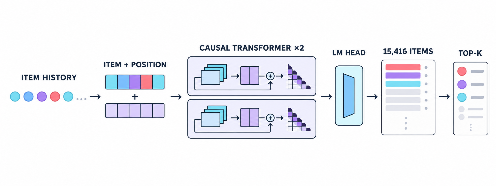
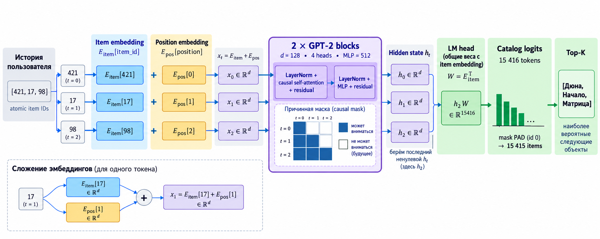

# T-Lab RecSys — GPTRec-base

Atomic-item GPT-2 baseline для next-item prediction на датасете KION.

## Результаты

| Модель | Split | Recall@10 | NDCG@10 |
|---|---|---:|---:|
| GPTRec-base | test | **0.2399** | **0.1439** |

Метрики посчитаны на 129 239 test-примерах. Лучшим оказался checkpoint после
10-й эпохи с `validation NDCG@10 = 0.1533`. Таблица будет дополняться результатами
reward model и RL-дообучения.

## Установка

```bash
uv sync --dev
```

## Загрузка данных

```bash
uv run python scripts/download_kion.py
```

Скрипт скачивает единый официальный архив KION `data_original.zip` с таблицами
`interactions`, `users` и `items`, затем распаковывает его в `downloads/kion/raw/`.

## Проверка данных

```bash
uv run python scripts/inspect_kion.py
```

Графики, схемы таблиц и HTML-отчёт сохраняются в `reports/generated/kion_eda/`.

## Подготовка датасета GPTRec-base

```bash
uv run python scripts/prepare_gptrec_base_data.py
```

Команда создаёт два независимых слоя:

- `data/interim/kion_common/` — interactions, users и items для будущих RM/RL-этапов;
- `data/processed/gptrec_base/` — atomic item tokens, временные split и vocabulary
  только для `GPTRec-base`.

`GPTRec-base` получает только `item_token_id`; feedback и metadata в baseline не подаются.

## Проверка Dataset/DataLoader

```bash
uv run python scripts/check_gptrec_dataloader.py
```

Команда только собирает последовательности и печатает их количество и формы батчей;
обучение модели она не запускает.

## Архитектура GPTRec-base



Последовательность atomic item ID превращается в item и positional embeddings, проходит
через два causal Transformer-блока и проецируется на полный каталог из 15 416 токенов.

### Как строится next-item prediction



Фактически LM head возвращает 15 416 logits: 15 415 объектов каталога и служебный
`PAD`. Перед ранжированием `PAD` маскируется, поэтому кандидатами остаются 15 415 items.
Схема показывает inference по последнему непустому hidden state; во время обучения
causal loss считается по всем допустимым переходам внутри train-последовательности.

## Создание модели

После подготовки датасета:

```bash
uv run python scripts/build_model.py
```

Размер vocabulary автоматически читается из `data/processed/gptrec_base/manifest.json`.

## Smoke test обучения

```bash
uv run python scripts/smoke_train.py
```

Команда выполняет 50 train-шагов, оценивает длительность полной эпохи и не сохраняет
checkpoint.

## Обучение GPTRec-base

### Конфигурация эксперимента

| Параметр | Значение |
|---|---:|
| Представление объектов | atomic item IDs |
| Vocabulary | 15 416 токенов, включая `PAD` |
| Максимальная длина последовательности | 32 |
| Transformer layers | 2 |
| Hidden size | 128 |
| Attention heads | 4 |
| MLP size | 512 |
| Dropout | 0.1 |
| Число параметров | 2 374 144 |
| Train / evaluation batch size | 32 / 256 |
| Optimizer | AdamW |
| Learning rate | 0.0003 |
| Weight decay | 0.01 |
| LR schedule | 5% warmup, затем linear decay |
| Эпохи | максимум 10, фактически 10 |
| Early stopping | минимум 3 эпохи, patience 2, min delta 0.0001 |
| Выбор checkpoint | максимум validation NDCG@10 |
| Seed / устройство | 42 / Apple MPS |

```bash
uv run python scripts/train_gptrec_base.py
```

Модель обучается максимум 10 эпох. После каждой эпохи сохраняется checkpoint и
считаются `Recall@5/10/20`, `NDCG@5/10/20` на validation. Начиная с третьей эпохи
обучение останавливается после двух эпох без улучшения `NDCG@10` хотя бы на `0.0001`.
Лучший checkpoint выбирается по `NDCG@10`, после чего test оценивается один раз.

Результаты:

- `artifacts/checkpoints/gptrec_base_standard/best.pt` — лучшая модель;
- `reports/generated/gptrec_base_standard/result.json` — итоговые метрики;
- `reports/generated/gptrec_base_standard/training_curves.png` — графики обучения.

## Проверки

```bash
uv run ruff check .
uv run pytest
```

