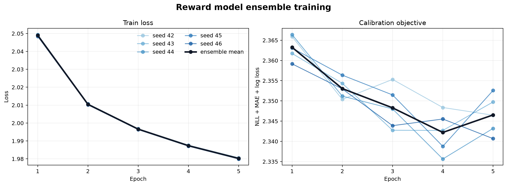
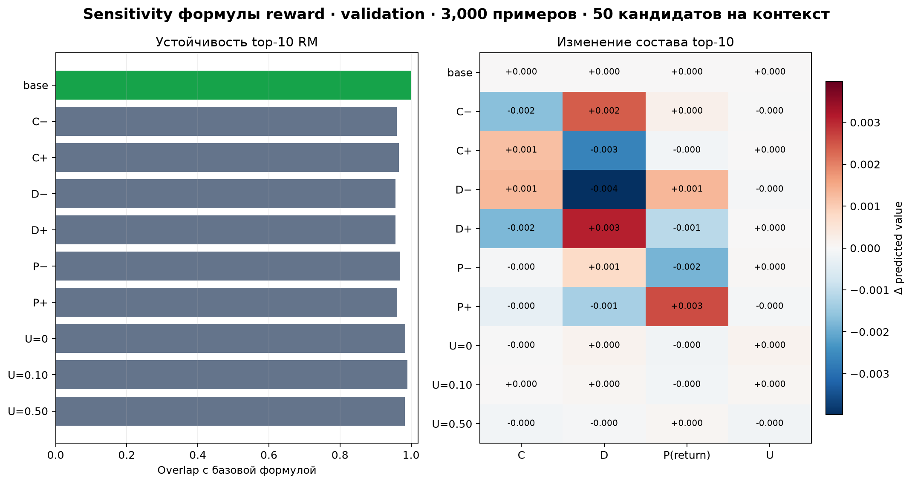
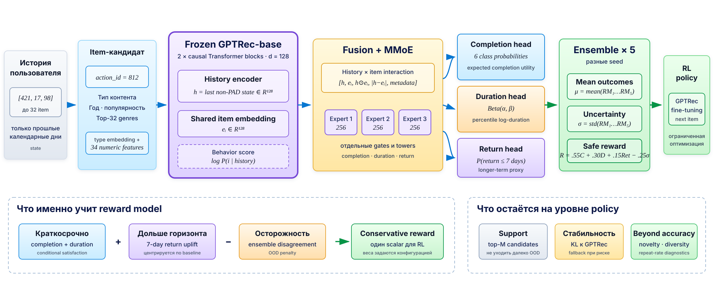

# T-Lab RecSys: GPTRec и Reward Model

## Основные результаты

### GPTRec-base

| Split | Примеров | Recall@10 | NDCG@10 |
|---|---:|---:|---:|
| Validation | — | — | **0.1533** |
| Test | 129 239 | **0.2399** | **0.1439** |

Лучший checkpoint выбран по `validation NDCG@10` после 10-й эпохи.

### Reward model

| Head | Метрика RM | RM | Константный baseline |
|---|---|---:|---:|
| Completion | NLL ↓ | **1.560** | 1.745 |
| Duration | MAE ↓ | **0.200** | 0.224 |
| Return | Log loss ↓ | **0.601** | 0.646 |

Итоговая функция Reward Model:


R = 0.55C + 0.30D + 0.15P(return) - 0.25U,


где `C` — ожидаемая completion utility, `D` — нормированная duration utility,
`P(return)` — вероятность возвращения пользователя, `U` — disagreement ансамбля.
Релевантность задаётся множеством top-M кандидатов GPTRec, а не отдельным слагаемым
reward.

## Воспроизведение

Требуются Python 3.11+ и [uv](https://docs.astral.sh/uv/).

```bash
uv sync --dev
```

### 1. Данные и GPTRec-base

```bash
uv run python scripts/download_kion.py
uv run python scripts/prepare_gptrec_base_data.py
uv run python scripts/train_gptrec_base.py
```

Основные результаты сохраняются в:

- `artifacts/checkpoints/gptrec_base_standard/best.pt`;
- `reports/generated/gptrec_base_standard/result.json`;
- `reports/generated/gptrec_base_standard/training_curves.png`.

### 2. Reward model

```bash
uv run python scripts/prepare_reward_model_data.py
uv run python scripts/train_reward_model.py
uv run python scripts/plot_reward_model_training.py
```

Обучается ансамбль из пяти моделей с разными seed. Checkpoints находятся в
`artifacts/checkpoints/reward_model/`, итоговые метрики — в
`reports/generated/reward_model/result.json`.



### 3. Диагностика reward

```bash
uv run python scripts/audit_reward_model.py
uv run python scripts/analyze_reward_sensitivity.py \
  --max-examples 3000 \
  --candidate-count 50 \
  --batch-size 64
```

Аудит проверяет связь reward с популярностью, зависимость от пользовательской истории
и различие uncertainty между head и tail items. Sensitivity-анализ выполняется на
validation и не переобучает модели.



## Архитектура

### GPTRec-base


GPT-2-подобный causal Transformer получает последовательность atomic item IDs и
предсказывает следующий объект из каталога. В baseline не используются feedback и
metadata.


| Параметр | Значение |
|---|---:|
| Максимальная длина | 32 |
| Transformer layers | 2 |
| Hidden size | 128 |
| Attention heads | 4 |
| Dropout | 0.1 |
| Параметров | 2 374 144 |
| Optimizer | AdamW |
| Learning rate | 0.0003 |

### Reward model



RM использует frozen GPTRec encoder, признаки кандидата, MMoE-блок и три
probabilistic head: completion, duration и return. Подробная схема, таргеты,
калибровка и ограничения описаны в
[документе по архитектуре RM](docs/reward-model-architecture.md).

## Диагностические выводы

- Spearman-корреляция reward с train-популярностью: `0.140`.
- Среднее изменение reward после перестановки историй: `0.029`.
- Tail items имеют большую uncertainty: `0.024` против `0.017` у head items.
- Изменение весов reward сохраняет `95.6–99.0%` состава исходного top-10.
- Штраф uncertainty почти не меняет порядок, поскольку среднее `U ≈ 0.016`.

## Ограничения

- В KION нет логов показов, поэтому selection bias нельзя полностью устранить.
- Offline reward не доказывает рост реальной удовлетворённости пользователя.
- Return — лишь прокси долгосрочного engagement.
- Новые действия policy могут оказаться вне обучающего распределения RM.
- Итоговый вывод об эффекте RL потребует одновременного анализа relevance, reward,
  popularity, repetition и multi-step generation.

## Проверки

```bash
uv run ruff check .
uv run pytest
```
