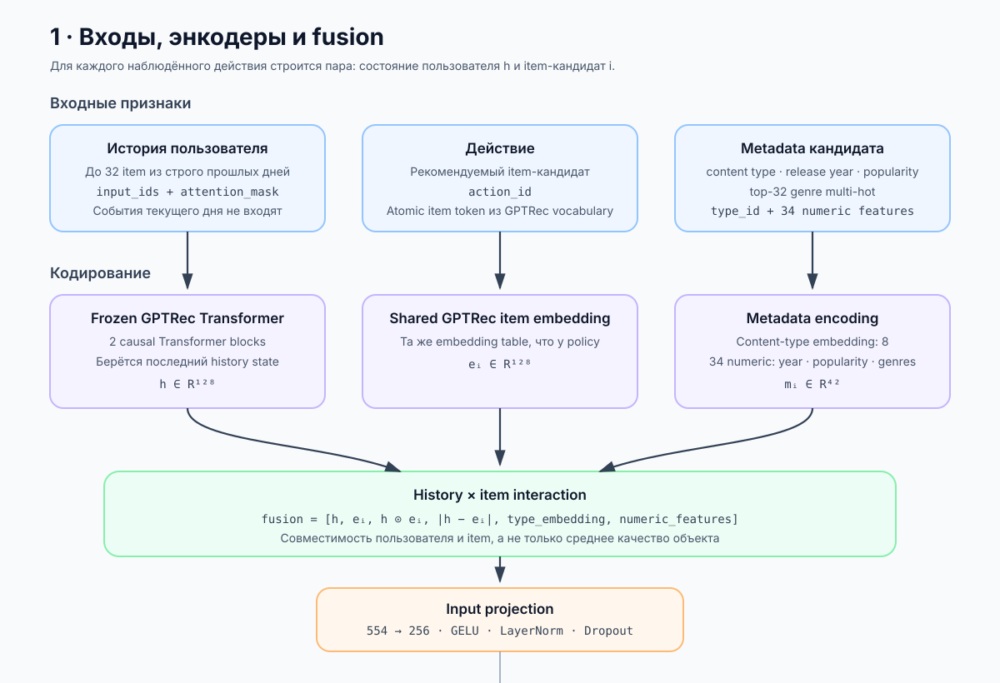
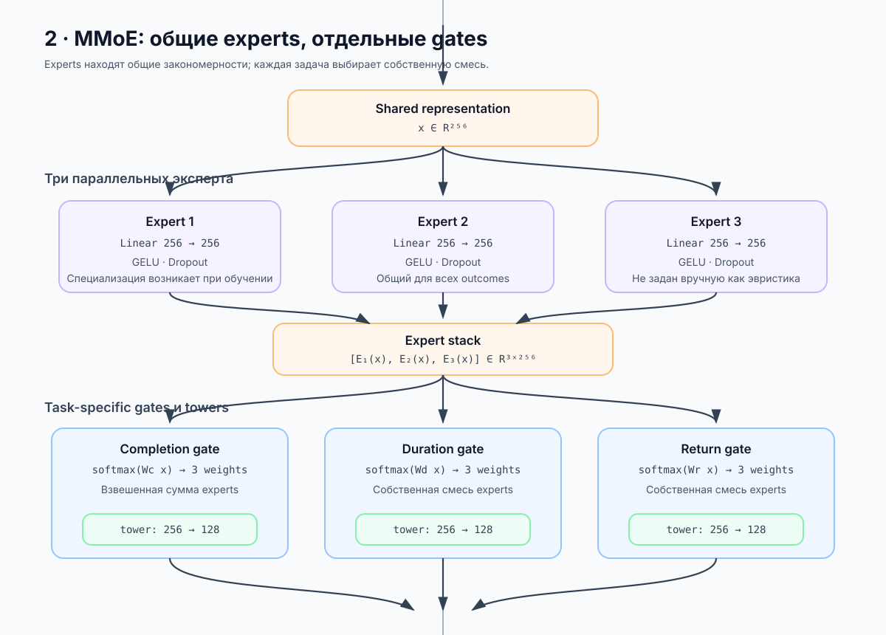
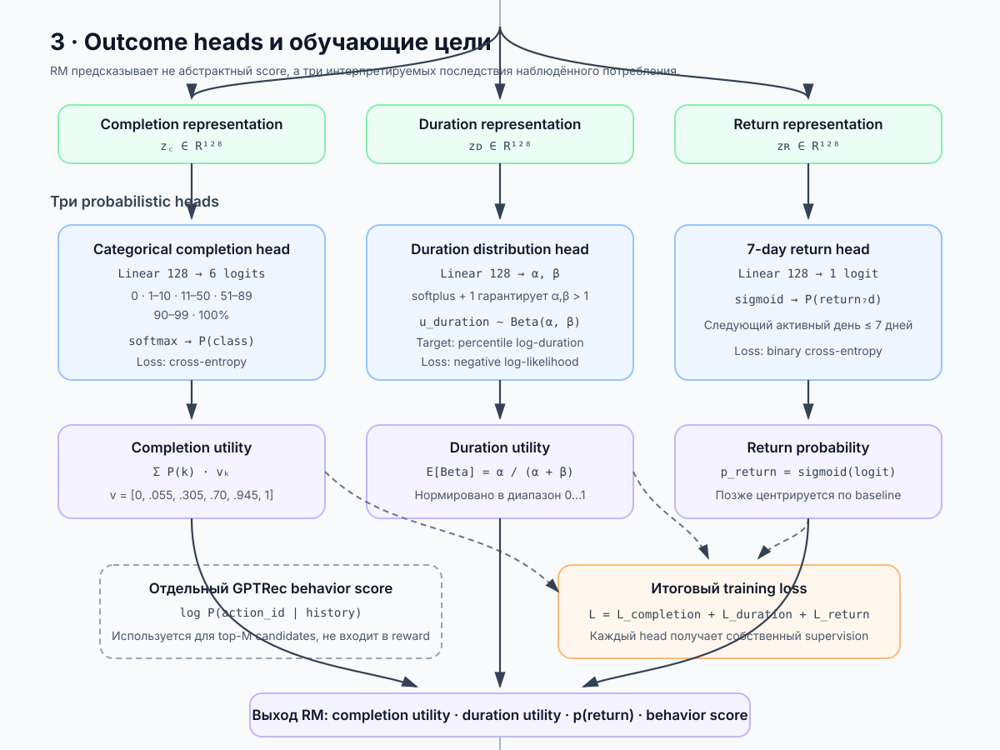
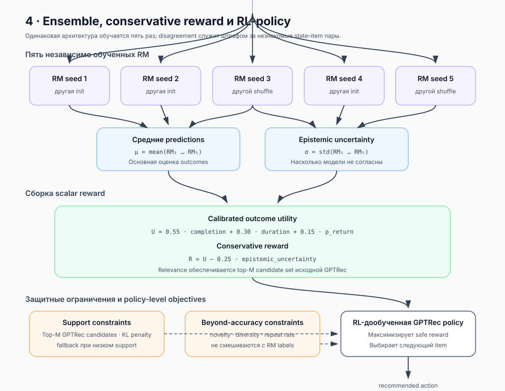

# Reward model architecture






Reward model получает пару `(история пользователя, item-кандидат)` и предсказывает
последствия выбора этого item. Модель не утверждает, что оценивает причинный эффект
показа: KION содержит только состоявшиеся взаимодействия и не содержит impressions.

### 1. Входы, энкодеры и fusion

- **История пользователя** — до 32 объектов, потреблённых строго раньше текущего
  календарного дня. События внутри дня не упорядочиваются искусственно.
- **History encoder** — Transformer из обученного GPTRec. Из него берётся последний
  непустой hidden state `h` размерности 128.
- **Item encoder** — embedding рекомендуемого `action_id` из той же таблицы GPTRec,
  формирующий вектор `e_i` размерности 128.
- **Metadata** — embedding типа контента и 34 числовых признака: нормализованный
  год выпуска, логарифм train-популярности item и multi-hot вектор top-32 жанров.
- **Fusion** объединяет `h`, `e_i`, их поэлементное произведение, абсолютную разность
  и metadata. Благодаря этому модель оценивает совместимость конкретного состояния
  пользователя с конкретным item, а не только среднее качество объекта.
- Проекция `554 → 256` создаёт общее представление `x` для MMoE.

### 2. MMoE

Три общих expert-сети получают одно представление `x`. Их специализация заранее не
задаётся: полезные закономерности возникают во время совместного обучения.

Для каждой задачи существует отдельный gate:

- completion gate;
- duration gate;
- return gate.

Gate вычисляет три softmax-веса и независимо смешивает выходы experts. Поэтому модель
completion может сильнее использовать одни закономерности, а модель возвращения —
другие. После смешивания отдельная task tower преобразует вектор `256 → 128`.

### 3. Probabilistic outcome heads

Reward model обучается предсказывать три наблюдаемых outcome:

1. **Completion:** categorical-классификация по шести упорядоченным категориям
   `watched_pct`. Cross-entropy не задаёт ordinal-структуру явно; порядок категорий
   используется при расчёте ожидаемой completion utility в диапазоне `[0, 1]`.
2. **Duration:** параметры Beta-распределения нормализованной duration utility.
   Target — percentile величины `log(1 + total_dur)`, рассчитанный отдельно для
   фильмов и сериалов по train-распределению.
3. **Return:** вероятность следующего активного дня пользователя в пределах семи
   дней.

Общий training loss равен сумме cross-entropy для completion, negative log-likelihood
для duration и binary cross-entropy для return.

GPTRec отдельно предоставляет `log P(action_id | history)`. Это behavior score по
positive-only истории, а не вероятность отклика после реального показа. В scalar
reward он не подставляется: GPTRec обеспечивает relevance, ограничивая действия
policy своим top-M candidate set.

### 4. Ensemble и итоговый reward

Пять одинаковых reward models обучаются с разными seed, инициализациями и порядком
перемешивания данных. Bootstrap по пользователям в текущем pipeline не выполняется.
Среднее прогнозов используется как основная оценка, а разброс — как приближение
epistemic uncertainty.

Conservative reward формируется напрямую из calibrated outcomes ансамбля:

```text
reward = 0.55 × completion_utility
       + 0.30 × duration_utility
       + 0.15 × p_return
       − 0.25 × epistemic_uncertainty
```

Uncertainty penalty снижает привлекательность state–item пар, на которых ансамбль
не согласен. Отдельные `relevance` и `baseline_return` не используются: первое
обеспечивается top-M GPTRec candidates, второе не вводится без action-independent
return model.
