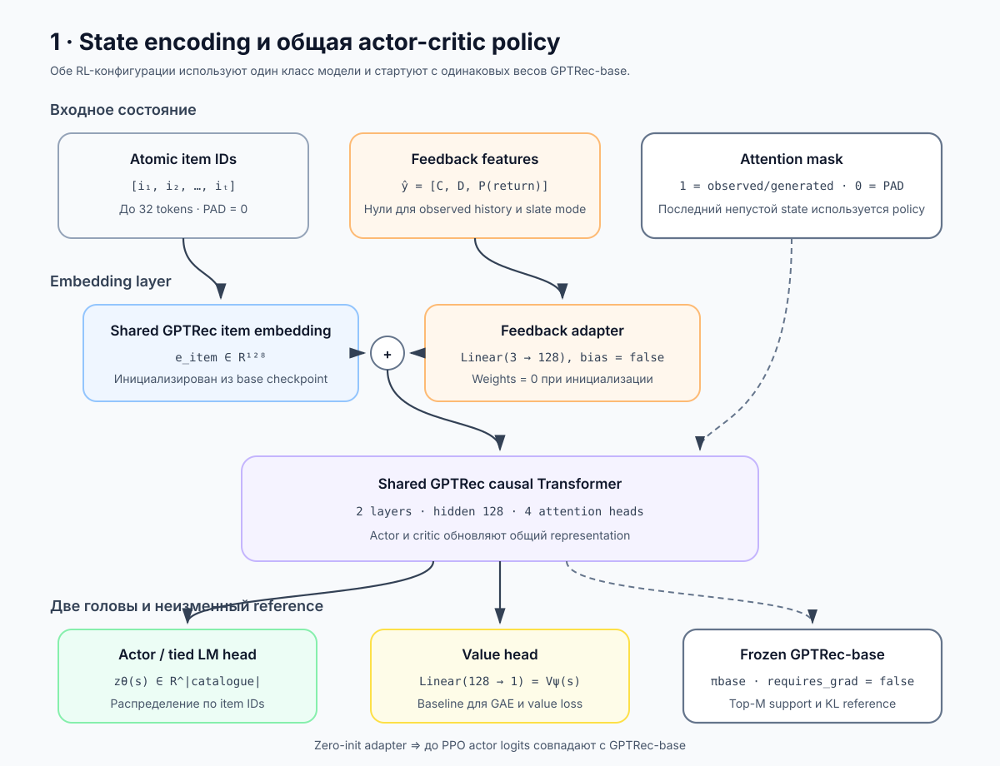
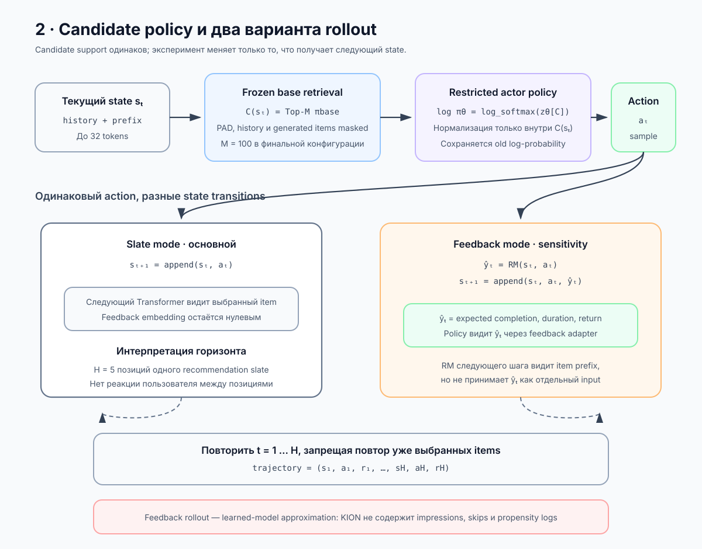
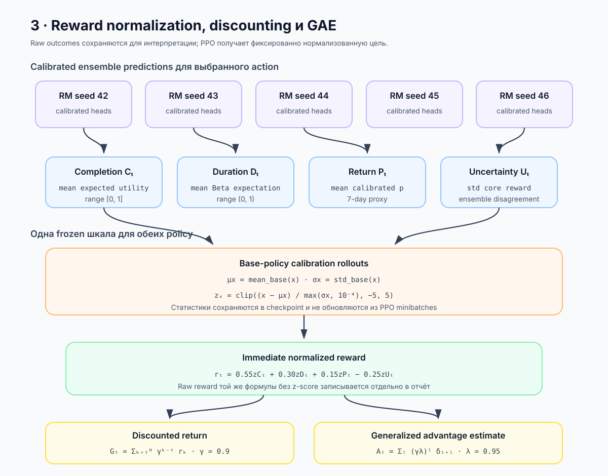
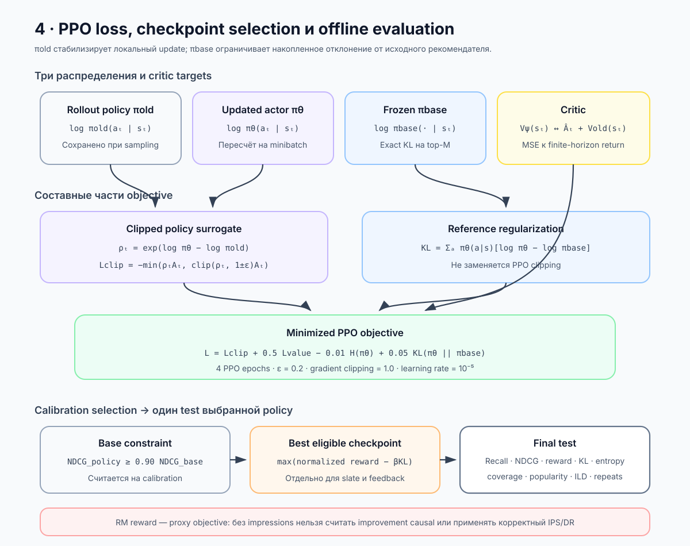

# PPO actor-critic architecture






Третий этап проекта дообучает `GPTRec-base` с помощью PPO. Реализованы две
сопоставимые конфигурации одной actor-critic архитектуры. Они начинают с одного
checkpoint, используют один frozen reference policy, один ансамбль reward models,
одинаковый top-M support и одинаковую нормализацию reward. Различается только
переход между состояниями.

### Два фактически выполненных режима

После длинного запуска со слабым KL был выполнен короткий запуск с более сильным
штрафом. Внутри каждого режима `slate` и `feedback` получают одинаковый бюджет и
вследствие одинакового seed проходят одну и ту же часть train.

| Параметр | Длинный запуск | Сильный KL |
|---|---:|---:|
| Конфигурация | `train_ppo.yaml` | `train_ppo_high_kl.yaml` |
| `β` | 0.05 | 0.5 |
| Train histories на policy | 475 456 (≈15% train) | 32 000 (≈1% train) |
| PPO updates на policy | 7 429 | 500 |
| Evaluation interval | 750 updates | 50 updates |
| Calibration histories | до 20 032 | до 6 400 |
| Rollout batch | 64 histories | 64 histories |
| Горизонт | 5 actions | 5 actions |
| Candidate support | Top-100 | Top-100 |
| PPO epochs на rollout | 4 | 4 |
| Minibatch | 128 transitions | 128 transitions |
| Reward-normalization batches | 100 | 100 |
| Test | весь split: 183 534 histories | весь split: 183 534 histories |

Calibration subset выбирается детерминированно и равномерно по всему Dataset, а не
как первые пользователи в порядке хранения. `test_batches: 0` означает оценку на
всём test split.

## 1. Общая policy

Actor и critic используют общий causal Transformer из `GPTRec-base`.

- **Actor head** — исходный tied LM head GPTRec над atomic item IDs.
- **Critic head** — новая линейная проекция последнего hidden state в `V(s)`.
- **Reference policy** — frozen копия исходной GPTRec. Она формирует top-M
  candidate set и задаёт распределение для KL-регуляризации.
- **Feedback adapter** — zero-initialized линейная проекция трёх outcome-признаков
  в hidden space GPTRec. Нулевая инициализация гарантирует, что до PPO-обновлений
  обе policy совпадают с base model.

Полный каталог не используется как пространство PPO-действий. Для каждого state
reference policy строит top-M кандидатов, после чего actor нормализует logits только
внутри этого множества:

```text
π(a | s, C(s)) = softmax(logits[a]),  a ∈ C(s).
```

Выбранные ранее и padding items маскируются. Такой frozen retrieval support уменьшает
стоимость обучения и не позволяет policy сразу уйти далеко за область GPTRec.

### Почему shared actor-critic

Отдельный Transformer для critic удвоил бы память и стоимость forward pass. Общий
backbone позволяет value head использовать то же представление истории, по которому
actor ранжирует items. Цена этого решения — value loss тоже обновляет Transformer,
поэтому его вес ограничен `value_coefficient = 0.5`, а общий gradient norm — единицей.

### Почему feedback adapter инициализирован нулями

Случайная проекция outcomes изменила бы logits ещё до первого RL-update, и
`PPO-feedback` стартовала бы не из той же policy, что `PPO-slate`. При нулевых весах
обе модели сначала воспроизводят GPTRec-base, но adapter всё равно получает gradient
после появления ненулевых generated feedback features.

## 2. Slate mode

Состояние на позиции `t`:

```text
s_t = (user_history, generated_items_<t).
```

После action в историю добавляется только его item ID. Реакция пользователя между
позициями списка не предполагается. Горизонт `H=5` означает построение одного
упорядоченного Top-5 slate, а не пять будущих пользовательских сессий.

Этот режим выбран как основной: он соответствует наблюдаемым данным, не подменяет
рекомендацию положительным взаимодействием и позволяет оптимизировать list-level
поведение autoregressive GPTRec.

## 3. Feedback mode

Состояние дополнительно содержит predictions reward model для ранее выбранных items:

```text
ŷ_t = (completion_t, duration_t, p_return_t)
s_t = (user_history, action_<t, ŷ_<t).
```

После каждого action ансамбль RM вычисляет ожидаемые outcomes. Feedback adapter
добавляет их embedding к embedding соответствующего item token при следующем вызове
Transformer. Используются ожидаемые значения, а не случайные labels: текущая RM не
возвращает полное совместное распределение пользовательской реакции.

Этот режим является **model-based sensitivity experiment**. KION не содержит
impressions, skips и logging propensities, поэтому RM обучена на состоявшихся
взаимодействиях. Её rollout нельзя интерпретировать как unbiased симуляцию реакции
на произвольный показ.

Дополнительное ограничение текущей реализации: feedback adapter влияет на policy,
но существующая RM следующего шага по-прежнему кодирует только последовательность
item IDs. Она не принимает предыдущие `ŷ` отдельным входом. Полностью feedback-aware
environment model потребовала бы другого RM-датасета и повторного обучения.

## 4. Нормализация reward

Ансамбль возвращает четыре компонента:

- `C` — expected completion utility;
- `D` — expected duration utility;
- `P_return` — вероятность следующего активного дня в пределах семи дней;
- `U` — disagreement пяти RM по core reward.

Перед PPO для каждого компонента один раз оцениваются `mean` и `std` на actions,
sampled из frozen base policy. Статистики после этого фиксируются:

```text
z_x = clip((x - mean_base(x)) / std_base(x), -5, 5)
R = 0.55 z_C + 0.30 z_D + 0.15 z_P_return - 0.25 z_U.
```

Одинаковая процедура применяется к `slate` и `feedback`. Нормализация не
пересчитывается на PPO minibatches: иначе меняющийся actor менял бы одновременно и
шкалу своей цели. В отчёты записываются как нормализованный reward для обучения, так
и исходный conservative reward для интерпретации.

Минимальный `std = 10⁻⁴` не даёт почти постоянному компоненту создать огромный
z-score. Дополнительный clip `[-5, 5]` ограничивает влияние редких выбросов ансамбля.

## 5. PPO objective

Rollouts собираются текущей policy, после чего finite-horizon GAE вычисляет
advantages:

```text
δ_t = r_t + γV(s_{t+1}) - V(s_t)
A_t = Σ_l (γλ)^l δ_{t+l}.
```

Минимизируемый loss:

```text
L = L_clip
  + c_v L_value
  - c_H H(π_RL)
  + β KL(π_RL || π_base).
```

PPO ratio использует policy, которой был собран rollout:

```text
ρ_t = π_RL(a_t | s_t) / π_old(a_t | s_t).
```

`π_old` и `π_base` имеют разные роли. Clipping ratio стабилизирует один PPO update,
а KL к неизменной base policy ограничивает накопленное отклонение от исходного
рекомендателя.

Entropy bonus действует только внутри top-M support и не разрешает выбирать item за
его пределами. Поэтому exploration остаётся ограниченным областью, которую исходная
GPTRec считает релевантной.

## 6. Выбор checkpoint

Checkpoint внутри каждого train-запуска выбирается только по calibration split.
Сначала измеряется base-policy
`NDCG@H`. PPO checkpoint считается допустимым, если сохраняет не менее 90% этого
значения. Среди допустимых выбирается максимум:

```text
normalized_reward_per_step - β × KL_per_step.
```

Если ни один checkpoint не выполняет relevance constraint, результат помечается как
не прошедший ограничение. Это произошло в длинном запуске `β=0.05`: его `best.pt` не
является допустимой итоговой policy по ограничению NDCG. В запуске `β=0.5`
calibration выбрала update 200 для slate и update 250 для feedback.

Для анализа переоптимизации все сохранённые checkpoints затем были повторно
оценены общим read-only скриптом на одном полном test. В этом исследовательском
сравнении update 50 показал более консервативную точку: около `+9.8%` raw reward при
падении NDCG только на `1.5–1.7%`. Это ретроспективный анализ test-траектории, а не
новый независимо выбранный final checkpoint; для строгого подтверждения этой точки
потребовался бы ещё один закрытый holdout.

## 7. Запуск

Длинный запуск `β=0.05`:

```bash
uv run python scripts/train_ppo.py --config configs/train_ppo.yaml
```

Короткий запуск `β=0.5`:

```bash
uv run python scripts/train_ppo.py --config configs/train_ppo_high_kl.yaml
```

К любой команде можно добавить `--mode slate` или `--mode feedback`, чтобы обучить
только одну policy. Результаты сохраняются раздельно:

```text
artifacts/checkpoints/ppo_final/slate/{update_750,...,update_7429,best,final}.pt
artifacts/checkpoints/ppo_final/feedback/{update_750,...,update_7429,best,final}.pt
artifacts/checkpoints/ppo_high_kl/slate/{update_050,...,update_500,best,final}.pt
artifacts/checkpoints/ppo_high_kl/feedback/{update_050,...,update_500,best,final}.pt
reports/generated/ppo_final/slate/result.json
reports/generated/ppo_final/feedback/result.json
reports/generated/ppo_high_kl/slate/result.json
reports/generated/ppo_high_kl/feedback/result.json
```

Единое повторное сравнение сохранённых policy:

```bash
uv run python scripts/evaluate_ppo_comparison.py
```

## 8. Что сравнивать

Итоговая таблица включает `GPTRec-base`, `PPO-slate` и `PPO-feedback` для двух
значений `β`. Для каждой policy рассчитаны:

- Recall/NDCG на одном candidate protocol;
- raw и normalized reward;
- KL к GPTRec-base и entropy;
- catalog coverage, popularity и repeat rate;
- concentration и unique slate rate.

Несколько seed, другие горизонты и более широкий sweep `β` остаются направлениями
дальнейшей работы, а не выполненными экспериментами.

Особенно важно показывать reward–NDCG Pareto frontier. Рост score той же RM, по
которой обучалась policy, не является независимым доказательством улучшения реального
пользовательского отклика.

### Если улучшения нет

Отсутствие одновременного роста reward и relevance не делает эксперимент
неуспешным. Для этой постановки это содержательный результат, если выполнены три
проверки:

1. PPO действительно меняет policy: KL больше нуля, entropy и action distribution
   отличаются от base.
2. Reward растёт хотя бы на части checkpoints, даже если NDCG ограничивает выбор.
3. `PPO-feedback` сравнивается со `slate` при том же compute и показывает, помогает
   ли simulated feedback или лишь усиливает model bias.

В итогах следует различать сценарии: `reward ↑ при NDCG ≈ const`, `reward ↑ при
NDCG ↓`, отсутствие значимого сдвига и reward overoptimization. Negative result
особенно правдоподобен здесь из-за ограниченного top-100 support, KL-регуляризации,
ограниченного compute и отсутствия impression logs. Нельзя ослаблять ограничения постфактум только
ради получения положительного результата.

## 9. Ограничения

- Top-M support улучшает устойчивость, но не исправляет selection bias KION.
- Feedback rollout использует conditional outcome predictor, а не причинную
  environment model.
- `P_return` — предсказанный outcome текущего item, не доказанный инкрементальный
  эффект рекомендации на retention.
- Полный IPS/DR OPE намеренно не используется: impressions и propensity logging
  policy отсутствуют.
- Feedback features исходной истории неизвестны и заданы нулями; модель получает их
  только для generated rollout items.
